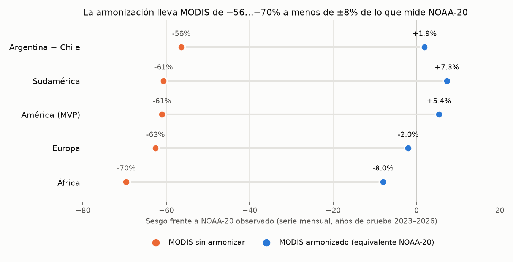
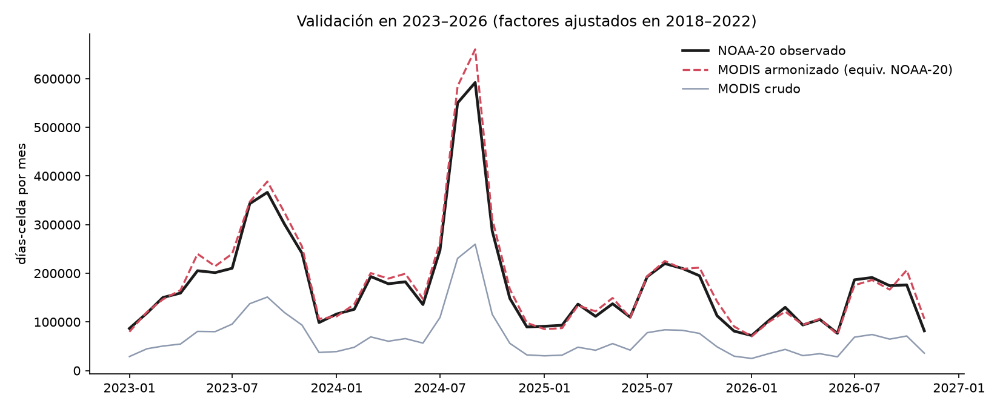

# Calendario armonizado de actividad de quema MODIS + VIIRS

**NASA Space Apps Challenge 2026 · Reto: "Harmonization of MODIS and VIIRS Hot Spots"** (propuesto por la CONAE, Argentina) · **Equipo MEIREKI**

> English version: [README.md](README.md)

Una aplicación web que muestra el **calendario de actividad de quema** de cualquier zona de América desde 2000 hasta noviembre de 2026,
como **una sola serie de tiempo comparable** aunque los datos provengan de satélites distintos. El usuario elige un país o dibuja un área,
identifica qué meses y qué años tuvieron más actividad de fuego, compara el mes actual con lo habitual en esa zona y descarga los datos y
las gráficas.

| | |
|---|---|
| **Código** | https://github.com/EvaristoRT/NASA-SpaceAppsChallenge |
| **Datos armonizados (release)** | https://github.com/EvaristoRT/NASA-SpaceAppsChallenge/releases |
| **Método, validación y decisiones del equipo** | [`pipeline/`](pipeline/) |

> **Alcance de la demo: solo América** (de Alaska a Tierra del Fuego), que es la región cargada en la aplicación.
> Europa y África se procesaron **solo para validar el método** en otros regímenes de fuego (resultados en la sección 3) y **no** están en la aplicación.
> Asia y Oceanía no se procesaron. El pipeline se ejecuta por región: incorporar un continente consiste en volver a ejecutarlo con `--region`.

*Este proyecto no cuenta con el respaldo de la NASA, la CONAE ni ninguna agencia espacial. Utiliza datos públicos de NASA FIRMS.*

---

## 1. El problema

Los satélites detectan fuego activo desde hace más de 20 años, pero el registro está dividido entre instrumentos que **no se pueden
comparar directamente**:

| Instrumento | Satélites | Años | Píxel |
|---|---|---|---|
| MODIS | Terra (desde 2000-11), Aqua (desde 2002-07) | 2000 → hoy, **al final de su vida útil** | ~1 km |
| VIIRS | S-NPP (2012-01 → **finalizó el 2026-11-02**), NOAA-20 (desde 2018-04), NOAA-21 (desde 2023-03) | 2012 → hoy | 375 m |

Para el mismo fuego, VIIRS registra **unas 4 veces más focos** que MODIS (píxel más pequeño y mayor sensibilidad). Combinar los conteos
crudos introduce discontinuidades artificiales: aumentos en 2002 (Aqua), 2012 (VIIRS) y 2018 (NOAA-20) que no corresponden a un cambio en
la actividad de fuego.

## 2. Metodología

### Enfoque general
Toda la serie se expresa en **"equivalente NOAA-20"**: desde 2018 corresponde a lo que mide NOAA-20, y los años anteriores se estiman
llevando cada satélite a esa escala con factores estimados en los años en que ambos sensores operaron de forma simultánea.

### Decisiones metodológicas

| Decisión | Justificación |
|---|---|
| **Referencia: VIIRS NOAA-20**, no MODIS ni S-NPP | S-NPP dejó de operar el 2026-11-02 (y en sus últimos meses perdía sensibilidad: NOAA-20 / S-NPP pasó de 0.98 a 1.26 entre enero y julio de 2026). MODIS está llegando al final de su misión: la razón Terra/Aqua, estable en ~0.50 entre 2003 y 2021, baja a 0.43 en 2024 y a 0.38 en 2025. NOAA-20 sigue activo y NOAA-21 concuerda con él dentro de ~1%. Así, **el periodo reciente corresponde a observaciones** y solo el periodo anterior es estimado |
| **Unidad: "día-celda con fuego"** = un hexágono H3 de resolución 8 (~0.7 km², similar a un píxel MODIS) con al menos un foco ese día | Elimina la mayor parte de la diferencia de huella: un frente que VIIRS divide en 20 detecciones de 375 m cuenta como un solo día-celda. Medido: la brecha NOAA-20 / MODIS baja de 3.98× (focos) a 2.84× (días-celda) |
| **Un factor por satélite; los satélites VIIRS nunca se suman entre sí** | Sumarlos introduce discontinuidades artificiales cada vez que entra en operación un satélite |
| **Tramo "solo Terra" por separado** (2000-11 → 2002-06) | Antes del lanzamiento de Aqua, la frecuencia de observación diaria era la mitad |
| **Segunda métrica: FRP** (potencia radiativa del fuego, MW), con su propio factor | Aporta la intensidad del fuego además de su ocurrencia. Depende menos del sensor que el conteo de focos, pero no es neutra (NOAA-20 / MODIS ≈ 0.7–0.85) |
| **Limpieza** de volcanes, plataformas marinas, mecheros de gas e industria | FIRMS marca muchas fuentes estáticas (`type` 1–3). Los datos recientes casi en tiempo real (NRT) no traen esa marca, por lo que se filtran con una **máscara de celdas estáticas** construida con el archivo histórico |

### El modelo
La armonización es un **estimador de razón estratificado con encogimiento hacia un factor global**. En primera aproximación, la
diferencia entre sensores es multiplicativa (el tamaño de píxel, la sensibilidad y el número de pasadas escalan las detecciones), y un
estimador de razón la modela de forma directa. Es estable con solo cinco años de traslape, da un factor físicamente interpretable por
región y mes, y su incertidumbre se puede cuantificar y validar en años que el modelo no vio.

- Para cada región (hexágono padre H3 de resolución 3, ~12,000 km²) y cada mes del año se calcula
  `factor = días-celda de NOAA-20 / días-celda del otro satélite`, en los meses en que ambos satélites operaban.
- Las regiones con pocos datos se **encogen hacia el factor global** (prior de pseudo-cuentas), lo que mantiene estables sus factores
  cuando la muestra de traslape es pequeña.
- Cadena hacia NOAA-20: S-NPP × `k_snpp` (2012–2018), MODIS × `k_modis` (2002–2011), Terra × `f_terra` × `k_modis` (2000–2002).
  Un solo paso en todos los casos, salvo el tramo solo Terra, que nunca coincidió con VIIRS.
- **Incertidumbre:** banda del 95% por **bootstrap** (200 réplicas, remuestreando hexágonos y años).

### El pipeline
Ocho pasos (`00`–`07`) en `pipeline/scripts/`, todos con DuckDB y Parquet. Cada script documenta sus entradas, salidas y reglas al inicio
del archivo.

| Paso | Qué hace |
|---|---|
| `00` / `00b` | Descarga el archivo histórico de FIRMS (zips anuales públicos) y el año en curso mediante la API de FIRMS, dividiendo cada bloque donde termina la calidad estándar |
| `01` | **Bronze:** convierte todos los registros a Parquet con un esquema único — **553 millones de focos**, 2000–2026, todo el mundo |
| `02` | Control de calidad: cobertura por satélite, nulos, duplicados, razón Terra/Aqua |
| `03` | **Silver:** limpieza, celdas H3 (resoluciones 8, 6, 5 y 3) y recorte por región |
| `04` | Tabla de calibración: días-celda, focos y FRP por hexágono × mes, **una columna por satélite** |
| `05` | Modelo: factores, banda por bootstrap y validación |
| `06` | **Gold:** serie armonizada por hexágono y día |
| `07` | Entrega para la aplicación: serie con anomalías, focos para el CSV y zips para publicar |

Decisiones y contratos de columnas: [`pipeline/PLAN_EQUIPO.md`](pipeline/PLAN_EQUIPO.md) · ejecución: [`pipeline/README.md`](pipeline/README.md).

## 3. Resultados y validación

**Validación temporal:** los factores se ajustan con **2018–2022** y se prueban en **2023–2026**, años que el modelo no vio, contra lo
que NOAA-20 midió realmente. La validación se realizó en cinco regiones: tres en América (la región de la aplicación y dos subconjuntos)
y, **solo como verificación independiente del método**, Europa y África.



| Región | Focos limpios | Factor MODIS → NOAA-20 | Sesgo sin → con armonizar | Error mediano mensual | Correlación | Meses dentro de la banda |
|---|---|---|---|---|---|---|
| Argentina + Chile | 14.6 M | 2.32 [2.24–2.42] | −56% → **+1.9%** | 8.7% | 0.995 | 95.7% |
| Sudamérica | 69.7 M | 2.65 [2.60–2.69] | −61% → **+7.3%** | 5.9% | 0.996 | 95.7% |
| **América (región de la aplicación)** | ~100 M | 2.64 [2.57–2.70] | −61% → **+5.4%** | 6.3% | 0.995 | 97.9% |
| Europa *(solo validación, no está en la aplicación)* | 10.5 M | 2.61 [2.54–2.83] | −63% → **−2.0%** | 11.5% | 0.993 | 89.4% |
| África *(solo validación, no está en la aplicación)* | 265.6 M | 3.03 [2.93–3.13] | −70% → **−8.0%** | 10.0% | 0.974 | 80.9% |

S-NPP → NOAA-20 (años 2012–2018): sesgo entre −0.8% y −2.7% y error mediano entre 2.0% y 3.9% en todas las regiones.

**Serie mensual de América en los años de prueba.** Negro: lo que midió NOAA-20. Rojo: MODIS llevado a escala NOAA-20. Gris: MODIS sin armonizar.



### Verificaciones adicionales
- **Sin discontinuidades artificiales en los cambios de sensor.** En 2013–2017, años sin NOAA-20, el mismo año llevado a NOAA-20 por dos
  caminos independientes (desde MODIS y desde S-NPP) coincide entre −3% y +4%.
- **El factor varía con el régimen de fuego, y la estratificación regional lo recoge.** En América, la franja boreal (Canadá y Alaska)
  tiene un factor de 2.27 frente a 2.66 en EE. UU., México y Sudamérica; validada por separado, su sesgo es de +6.9%.
- **Fuentes industriales residuales:** 0.4% de los días-celda en América, 1.7% en Europa (acerías), 0.15% en África.
- **Evidencia de degradación de MODIS.** En África el sesgo de la prueba es +0.7% (2023) y −1.9% (2024), y luego −10.3% (2025) y −23.7%
  (2026), mientras Terra/Aqua baja de 0.37 a 0.21. No afecta al producto (desde 2018 la serie es NOAA-20 medido y los factores se aplican
  a 2002–2011), pero respalda la elección de VIIRS como referencia.
- **Interpretación de la banda de incertidumbre:** la incertidumbre del factor en sí es pequeña (entre ±2% y +8% según la región); lo que
  más varía es la relación entre sensores de un año a otro. La banda mostrada **contiene el valor observado en el 95.7–97.9% de los meses
  de prueba en América y Sudamérica** (menos en Europa y África). Es una banda verificada empíricamente, no un intervalo de confianza del
  total en sentido estricto.

Todas las cifras y cómo se obtuvieron: [`pipeline/HALLAZGOS_QA.md`](pipeline/HALLAZGOS_QA.md), [`pipeline/REGIONES.md`](pipeline/REGIONES.md),
[`pipeline/MVP_AMERICA.md`](pipeline/MVP_AMERICA.md). Prueba del producto contra cada punto del reto: [`pipeline/PRUEBA_RETO.md`](pipeline/PRUEBA_RETO.md).

## 4. La aplicación

- **Elegir la zona:** países de América en el mapa, **polígono dibujado** o **coordenadas escritas**. El mapa permite recorrer todos los
  continentes, pero solo América tiene datos: fuera de ella el panel indica "sin datos para esta zona" en lugar de mostrar una serie en cero.
- **Calendario de quema** de años × meses, con rampas de color perceptualmente uniformes y aptas para daltonismo, navegable con teclado.
- **Mes actual frente a lo habitual** en la zona (mediana 2003–2020), con anomalía y percentil. El mes en curso se marca como parcial y
  los meses recientes como preliminares (NRT).
- **Meses siguientes:** el rango esperado según la historia de la zona, identificado como "esperado, no medido".
- **Serie con su banda de incertidumbre** y la fuente de cada mes.
- **Selector de periodo**, conteo de focos del área y **descargas**: CSV de la serie, de los hexágonos de un mes y de los **focos
  individuales recortados al polígono exacto**, además de las gráficas en PNG.
- Mapa de los hexágonos con fuego del mes elegido. Español e inglés.

Tecnologías: **pipeline** Python + DuckDB + Parquet + H3 · **backend** FastAPI · **frontend** React + Vite + Mapbox GL, desplegable en Vercel.

## 5. Ejecución local

Se requiere Python 3.12+, Node 20+, un token **público** de Mapbox (empieza con `pk.`) y la carpeta de la entrega de datos
(`ignis-backend-america.zip` descomprimido).

```powershell
# backend
cd backend
python -m venv .venv
.venv\Scripts\Activate.ps1
pip install -r requirements.txt
$env:DATA_DIR = "C:\ruta\a\entrega_america"
uvicorn main:app --port 8000
```

```powershell
# frontend (otra terminal)
cd frontend
npm install
# crear frontend\.env.local con dos líneas:
#   VITE_MAPBOX_TOKEN=pk.tu_token
#   VITE_API_URL=http://localhost:8000
npm run dev
```

Con la entrega de América, el backend usa ~0.8 GB de memoria en reposo y ~1.9 GB al consultar el continente completo.
Más detalle en [`backend/README.md`](backend/README.md) y [`frontend/README.md`](frontend/README.md). Despliegue: [`pipeline/DESPLIEGUE.md`](pipeline/DESPLIEGUE.md).

Para reconstruir los datos desde cero (archivo de FIRMS → entrega), ver [`pipeline/README.md`](pipeline/README.md). En una laptop de
16 GB, la capa bronze mundial tomó cerca de 1.5 horas, y cada región entre unos minutos y unas 2.5 horas según su tamaño (África, la más grande).

## 6. Limitaciones

- **MODIS no puede validarse de forma independiente antes de 2012** (VIIRS aún no operaba). En Argentina + Chile la razón Terra/Aqua sube
  de 0.47 (2003) a ~0.62 (2011), y no es posible determinar si refleja la actividad de fuego o el comportamiento del sensor. Es el tramo
  menos verificable de la serie.
- **El tramo solo Terra (2000-11 → 2002-06) tiene la banda más ancha**, porque su factor se encadena a través de MODIS.
- **Los meses recientes de 2026 son preliminares (NRT):** la NASA los reemplaza por la versión estándar unos 5 meses después. El sesgo
  entre ambas versiones no se puede medir (no se solapan). Corte de los datos: **2026-11-15**.
- **La aplicación cubre solo América.** Europa y África están procesadas y validadas (cifras arriba) pero no cargadas en la aplicación,
  y Asia y Oceanía no se procesaron. Servir más regiones requiere un servidor mayor: América usa ~1.9 GB en el pico y África sola
  necesitaría ~8 GB.
- **Las regiones son rectángulos**, no fronteras. En 2026 no hay datos para Galápagos ni el este de Groenlandia (casi sin fuegos de vegetación).
- **Algunas fuentes industriales** no están marcadas por FIRMS: ~0.4% de los días-celda en América, 1.7% en Europa.
- **En África la armonización es menos precisa** (la banda contiene el 81% de los meses, sesgo −8%): MODIS se degrada en 2025–2026 y el
  efecto es mayor en esa región.
- **La unidad es "día-celda con fuego", no "focos".** Es lo que hace comparables los sensores; el número de focos crudos se muestra por
  separado y está en el CSV.

## 7. Uso de herramientas de IA (Super Intelligence)

De acuerdo con las reglas de NASA Space Apps, declaramos dónde se utilizaron herramientas de IA:

- **Código y procesamiento de datos:** los integrantes del equipo usaron asistentes de programación con IA (modelos de lenguaje, p. ej.
  Claude) para escribir, revisar y depurar los scripts del pipeline (`pipeline/`), el backend (`backend/`), el frontend (`frontend/`) y
  los archivos de despliegue (`deploy/`). Los asistentes trabajaron según las instrucciones escritas del equipo (`AGENTS.md`, `CLAUDE.md`).
- **Análisis y documentación:** los asistentes de IA ayudaron a ejecutar y resumir los controles de calidad y las validaciones, y a
  redactar la documentación de `pipeline/*.md` y de este README.
- **Lo que el equipo decidió y verificó:** las decisiones de método (referencia NOAA-20, unidad día-celda, validación temporal) las tomó
  el equipo, y cada cifra reportada proviene de ejecutar el código sobre datos de NASA FIRMS. Los resultados clave se contrastaron con
  cálculos independientes (por ejemplo, totales por polígono y conteos de focos frente a consultas directas sobre los datos).
- **Imágenes:** las gráficas de `docs/img/` las genera nuestro propio código a partir de los datos. Los patrones de diseño y el símbolo de
  `design/brand/` y `frontend/public/brand/` son recursos oficiales de la marca NASA Space Apps, no generados con IA.

## 8. Datos, software y créditos

**Datos de la NASA**
- **NASA FIRMS** (Fire Information for Resource Management System), LANCE / Earthdata: fuegos activos MODIS Collection 6.1 (Terra, Aqua)
  y fuegos activos VIIRS 375 m (S-NPP, NOAA-20, NOAA-21).
  - Descripción y cita: https://www.earthdata.nasa.gov/data/tools/firms
  - Descarga del archivo histórico (archivos anuales por país): https://firms.modaps.eosdis.nasa.gov/download/
  - API de área (año en curso, NRT y calidad estándar): https://firms.modaps.eosdis.nasa.gov/api/

**Otros datos y servicios**
- Fronteras de países para la lista de zonas: **Natural Earth** 1:110m (dominio público) — https://www.naturalearthdata.com/
- Mapa base, relieve y límites de países: **Mapbox** (Mapbox GL JS, `mapbox.mapbox-terrain-dem-v1`, `mapbox.country-boundaries-v1`) — https://www.mapbox.com/
- Grilla hexagonal: **H3** (Uber) — https://h3geo.org/
- Reto y contexto: **CONAE** (Comisión Nacional de Actividades Espaciales, Argentina).

**Software**
- Pipeline: Python, DuckDB (con su extensión H3), Apache Arrow / Parquet, pandas, NumPy, matplotlib.
- Backend: FastAPI, Uvicorn, pandas, PyArrow, NumPy, h3.
- Frontend: React, Vite, Mapbox GL JS, d3-scale-chromatic (rampas viridis, cividis, inferno y magma), íconos Lucide,
  fuente Source Sans 3 (SIL Open Font License).
- Marca: símbolo y patrones de NASA Space Apps tomados de los recursos oficiales de la marca Space Apps. No se usa el logotipo de la NASA.
