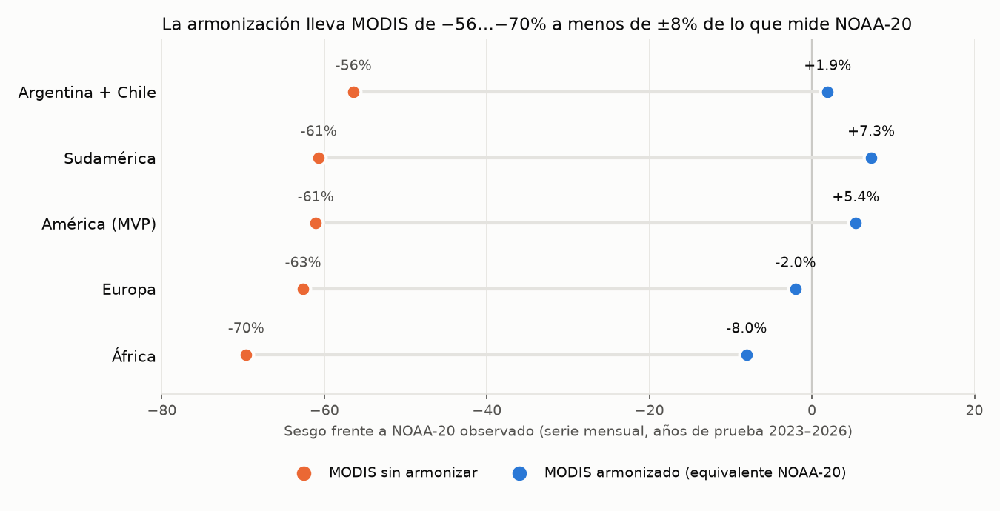
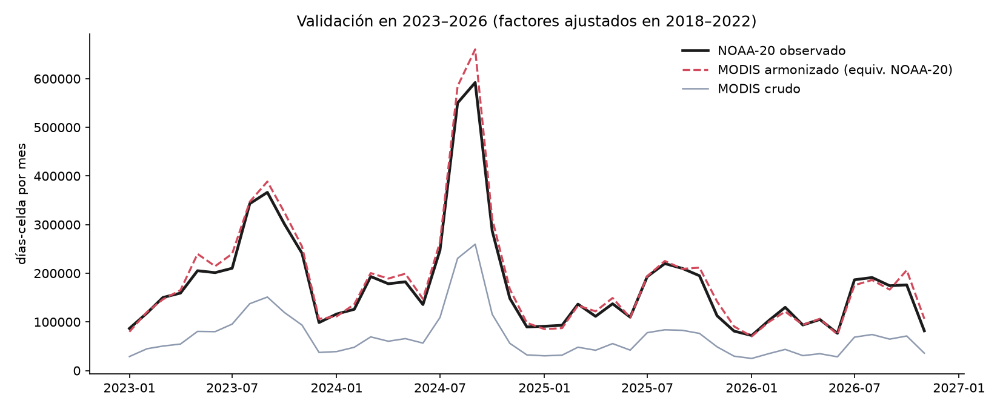

# Harmonized MODIS + VIIRS Burning Activity Calendar

**NASA Space Apps Challenge 2026 · Challenge: "Harmonization of MODIS and VIIRS Hot Spots"** (proposed by CONAE, Argentina) · **Team MEIREKI**

> 🇪🇸 Versión en español: [README.es.md](README.es.md)

A web application that shows the **burning activity calendar** of any area in the Americas from 2000 to November 2026, as **one
comparable time series** even though the data come from different satellites. Users pick a country or draw an area, see which months and
years had the most fire, compare the current month with what is normal for that area, and download the data and the charts.

| | |
|---|---|
| **Code** | https://github.com/EvaristoRT/NASA-SpaceAppsChallenge |
| **Harmonized data (release)** | https://github.com/EvaristoRT/NASA-SpaceAppsChallenge/releases |
| **Method, validation and team decisions** | [`pipeline/`](pipeline/) (Spanish) |

*This project is not endorsed by NASA, CONAE or any space agency. It uses public NASA FIRMS data.*

---

## 1. The problem

Satellites have detected active fires for more than 20 years, but the record is split across instruments that **cannot be compared
directly**:

| Instrument | Satellites | Years | Pixel |
|---|---|---|---|
| MODIS | Terra (from 2000-11), Aqua (from 2002-07) | 2000 → today, **at the end of its life** | ~1 km |
| VIIRS | S-NPP (2012-01 → **ended 2026-11-02**), NOAA-20 (from 2018-04), NOAA-21 (from 2023-03) | 2012 → today | 375 m |

For the same fire, VIIRS reports **about 4 times more hotspots** than MODIS (smaller pixel, higher sensitivity). Adding raw counts invents
trends: the series "jumps" in 2002 (Aqua starts), 2012 (VIIRS starts) and 2018 (NOAA-20 starts) without any extra fire.

## 2. What we built

### The idea in one sentence
The whole series is expressed as **"NOAA-20 equivalent"**: from 2018 on it is what NOAA-20 measures, and earlier years are estimated by
bringing each satellite to that scale with factors learned in the years when both were flying.

### Method decisions (and why)

| Decision | Why |
|---|---|
| **Reference: VIIRS NOAA-20**, not MODIS or S-NPP | S-NPP stopped on 2026-11-02 (and was losing sensitivity in its last months: NOAA-20 / S-NPP went from 0.98 to 1.26 between January and July 2026). MODIS is fading: the Terra/Aqua ratio, stable at ~0.50 in 2003–2021, falls to 0.43 in 2024 and 0.38 in 2025. NOAA-20 is active and NOAA-21 agrees with it within ~1%. This way **the present is measured data** and only the past is estimated |
| **Unit: "burning cell-day"** = one H3 hexagon at resolution 8 (~0.7 km², close to a MODIS pixel) with at least one hotspot that day | Removes most of the footprint difference: a fire front that VIIRS splits into 20 detections of 375 m counts as one cell-day. Measured: the NOAA-20 / MODIS gap drops from 3.98× (hotspots) to 2.84× (cell-days) |
| **One factor per satellite; VIIRS satellites are never added together** | Adding them creates false jumps every time a satellite is launched |
| **Separate "Terra only" period** (2000-11 → 2002-06) | Before Aqua, observation capacity was half |
| **Second metric: FRP** (fire radiative power, MW), with its own factor | Measures how much burns, not only where. It depends less on the sensor than hotspot counts, but it is not neutral (NOAA-20 / MODIS ≈ 0.7–0.85) |
| **Cleaning** of volcanoes, offshore platforms, gas flares and industry | FIRMS flags many static sources (`type` 1–3). Recent near-real-time (NRT) data has no such flag, so it is filtered with a **static-cell mask** built from the archive |

### The model
It is not a neural network: it is a **ratio model**, chosen because it can be explained in one sentence and validated with real data.

- For each region (H3 parent hexagon at resolution 3, ~12,000 km²) and each calendar month we compute
  `factor = NOAA-20 cell-days / other satellite's cell-days`, over the months when both satellites were operating.
- Regions with little data are **shrunk toward the global factor** (pseudo-count prior), so they do not produce extreme factors.
- Chain to NOAA-20: S-NPP × `k_snpp` (2012–2018), MODIS × `k_modis` (2002–2011), Terra × `f_terra` × `k_modis` (2000–2002).
  A single step everywhere, except the Terra-only period, which never overlapped with VIIRS.
- **Uncertainty:** 95% band by **bootstrap** (200 replicates, resampling hexagons and years).

### The pipeline
Seven steps in `pipeline/scripts/`, all with DuckDB and Parquet. Each script documents its inputs, outputs and rules at the top of the file.

| Step | What it does |
|---|---|
| `00` / `00b` | Downloads the FIRMS archive (public yearly zips) and the current year through the FIRMS API, splitting each block where standard-quality data ends |
| `01` | **Bronze:** converts everything to Parquet with one schema — **553 million hotspots**, 2000–2026, worldwide |
| `02` | Quality checks: coverage by satellite, nulls, duplicates, Terra/Aqua ratio |
| `03` | **Silver:** cleaning, H3 cells (resolutions 8, 6, 5 and 3) and clipping by region |
| `04` | Calibration table: cell-days, hotspots and FRP per hexagon × month, **one column per satellite** |
| `05` | Model: factors, bootstrap band and validation |
| `06` | **Gold:** harmonized series per hexagon and day |
| `07` | Delivery for the app: series with anomalies, hotspots for the CSV, and zips to publish |

Decisions and column contracts: [`pipeline/PLAN_EQUIPO.md`](pipeline/PLAN_EQUIPO.md) · how to run it: [`pipeline/README.md`](pipeline/README.md).

## 3. Results: does the harmonization work?

**Temporal validation:** factors are fitted on **2018–2022** and tested on **2023–2026**, years the model never saw, against what NOAA-20
actually measured. We did it in five regions.



| Region | Clean hotspots | MODIS → NOAA-20 factor | Bias raw → harmonized | Median monthly error | Correlation | Months inside the band |
|---|---|---|---|---|---|---|
| Argentina + Chile | 14.6 M | 2.32 [2.24–2.42] | −56% → **+1.9%** | 8.7% | 0.995 | 95.7% |
| South America | 69.7 M | 2.65 [2.60–2.69] | −61% → **+7.3%** | 5.9% | 0.996 | 95.7% |
| **Americas (the one in the app)** | ~100 M | 2.64 [2.57–2.70] | −61% → **+5.4%** | 6.3% | 0.995 | 97.9% |
| Europe | 10.5 M | 2.61 [2.54–2.83] | −63% → **−2.0%** | 11.5% | 0.993 | 89.4% |
| Africa | 265.6 M | 3.03 [2.93–3.13] | −70% → **−8.0%** | 10.0% | 0.974 | 80.9% |

S-NPP → NOAA-20 (years 2012–2018): bias between −0.8% and −2.7% and median error between 2.0% and 3.9% in every region.

**Monthly series of the Americas in the test years.** Black: what NOAA-20 measured. Red: MODIS brought to the NOAA-20 scale. Gray: raw MODIS.



### Other checks
- **No false jumps when the satellite changes.** In 2013–2017, years without NOAA-20, the same year brought to NOAA-20 through two
  independent paths (from MODIS and from S-NPP) agrees within −3% to +4%.
- **The factor changes with the type of fire, and the model captures it.** In the Americas, the boreal belt (Canada and Alaska) has a
  factor of 2.27 against 2.66 in the US, Mexico and South America; validated on its own, its bias is +6.9%.
- **Industrial sources that slip through:** 0.4% of cell-days in the Americas, 1.7% in Europe (steel plants), 0.15% in Africa.
- **MODIS is degrading, and it shows.** In Africa the test bias is +0.7% (2023) and −1.9% (2024), then −10.3% (2025) and −23.7% (2026),
  while Terra/Aqua falls from 0.37 to 0.21. It does not affect the product (from 2018 the series is measured NOAA-20, and the factors are
  applied to 2002–2011), but it is the clearest argument for using VIIRS as the reference.
- **How to read the band:** the uncertainty of the factor itself is small (between ±2% and +8% depending on the region); what varies most
  is the ratio between sensors from one year to the next. The band shown **contains the real value in 95.7–97.9% of the test months in the
  Americas and South America** (less in Europe and Africa). It is an empirically checked band, not a confidence interval of the total in
  the strict sense.

All the figures and how they were obtained (Spanish): [`pipeline/HALLAZGOS_QA.md`](pipeline/HALLAZGOS_QA.md), [`pipeline/REGIONES.md`](pipeline/REGIONES.md),
[`pipeline/MVP_AMERICA.md`](pipeline/MVP_AMERICA.md). The product tested against every point of the challenge: [`pipeline/PRUEBA_RETO.md`](pipeline/PRUEBA_RETO.md).

## 4. The application

- **Choose the area:** continents and countries on the map, a **drawn polygon**, or **typed coordinates**.
- **Burning calendar** of years × months, with perceptually uniform, colorblind-safe color ramps, navigable with the keyboard.
- **Current month against normal** for the area (2003–2020 median), with anomaly and percentile. The month in progress is marked as
  partial and recent months as preliminary (NRT).
- **Upcoming months:** the expected range from the area's history, labeled "expected, not measured".
- **Series with its uncertainty band** and the source of each month.
- **Period selector**, hotspot count for the area, and **downloads**: CSV of the series, of the hexagons of one month and of the
  **individual hotspots clipped to the exact polygon**, plus the charts as PNG.
- Map of the hexagons with fire in the chosen month. Spanish and English.

Stack: **pipeline** Python + DuckDB + Parquet + H3 · **backend** FastAPI · **frontend** React + Vite + Mapbox GL, deployable on Vercel.

## 5. Run it on your computer

You need Python 3.12+, Node 20+, a **public** Mapbox token (starts with `pk.`) and the data delivery folder
(`ignis-backend-america.zip` unzipped).

```powershell
# backend
cd backend
python -m venv .venv
.venv\Scripts\Activate.ps1
pip install -r requirements.txt
$env:DATA_DIR = "C:\path\to\entrega_america"
uvicorn main:app --port 8000
```

```powershell
# frontend (another terminal)
cd frontend
npm install
# create frontend\.env.local with two lines:
#   VITE_MAPBOX_TOKEN=pk.your_token
#   VITE_API_URL=http://localhost:8000
npm run dev
```

With the Americas delivery the backend uses ~0.8 GB of memory at rest and ~1.9 GB when querying the whole continent.
More detail in [`backend/README.md`](backend/README.md) and [`frontend/README.md`](frontend/README.md). Deployment: [`pipeline/DESPLIEGUE.md`](pipeline/DESPLIEGUE.md).

To rebuild the data from scratch (FIRMS archive → delivery), see [`pipeline/README.md`](pipeline/README.md). On a 16 GB laptop the
worldwide bronze layer took about 1.5 hours, and each region from minutes to about 2.5 hours depending on its size (Africa, the largest).

## 6. Limitations (we state them before anyone finds them)

- **Before 2012 there is nothing to check MODIS against** (VIIRS did not exist). In Argentina + Chile the Terra/Aqua ratio rises from 0.47
  (2003) to ~0.62 (2011), and we cannot tell whether that is the fire or the sensor. It is the least verifiable part of the series.
- **The Terra-only period (2000-11 → 2002-06) carries the widest band**, because its factor is chained through MODIS.
- **Recent months of 2026 are preliminary (NRT):** NASA replaces them with the standard version about 5 months later. The bias between
  both versions cannot be measured (they do not overlap). Data cut-off: **2026-11-15**.
- **The app shows the Americas.** Europe and Africa are processed and validated (figures above) but not loaded in the app.
- **Regions are rectangles**, not borders. In 2026, Galápagos and eastern Greenland have no data (almost no vegetation fires there).
- **Some industrial sources** are not flagged by FIRMS: ~0.4% of cell-days in the Americas, 1.7% in Europe.
- **In Africa the harmonization is less precise** (the band contains 81% of the months, bias −8%): MODIS degrades in 2025–2026 and it
  weighs more there.
- **The unit is "burning cell-days", not "hotspots".** It is what makes the sensors comparable; the raw hotspot count is shown separately
  and is in the CSV.

## 7. Use of AI (Super Intelligence) tools

In line with the NASA Space Apps rules, we declare where AI tools were used:

- **Code and data processing:** team members used AI coding assistants (large language models, e.g. Claude) to help write, review and
  debug the pipeline scripts (`pipeline/`), the backend (`backend/`), the frontend (`frontend/`) and the deployment files (`deploy/`).
  The assistants worked under the team's written instructions (`AGENTS.md`, `CLAUDE.md`).
- **Analysis and documentation:** AI assistants helped run and summarize quality checks and validations, and helped draft the
  documentation in `pipeline/*.md` and this README.
- **What the team did and checked:** the method choices (NOAA-20 reference, cell-day unit, temporal validation) were decided by the team,
  and every reported figure comes from running the code on NASA FIRMS data. Key results were cross-checked with independent calculations
  (for example, polygon totals and hotspot counts against direct queries on the data).
- **Images:** the charts in `docs/img/` are produced by our own code from the data. The design patterns and symbol in `design/brand/` and
  `frontend/public/brand/` are official NASA Space Apps brand assets, not AI-generated.

## 8. Data, software and credits

**NASA data**
- **NASA FIRMS** (Fire Information for Resource Management System), LANCE / Earthdata: MODIS Collection 6.1 active fires (Terra, Aqua) and
  VIIRS 375 m active fires (S-NPP, NOAA-20, NOAA-21).
  - Overview and citation: https://www.earthdata.nasa.gov/data/tools/firms
  - Archive download (yearly files by country): https://firms.modaps.eosdis.nasa.gov/download/
  - Area API (current year, NRT and standard quality): https://firms.modaps.eosdis.nasa.gov/api/

**Other data and services**
- Country borders for the zone list: **Natural Earth** 1:110m (public domain) — https://www.naturalearthdata.com/
- Base map, terrain and country boundaries: **Mapbox** (Mapbox GL JS, `mapbox.mapbox-terrain-dem-v1`, `mapbox.country-boundaries-v1`) — https://www.mapbox.com/
- Hexagonal grid: **H3** (Uber) — https://h3geo.org/
- Challenge and context: **CONAE** (Comisión Nacional de Actividades Espaciales, Argentina).

**Software**
- Pipeline: Python, DuckDB (with its H3 extension), Apache Arrow / Parquet, pandas, NumPy, matplotlib.
- Backend: FastAPI, Uvicorn, pandas, PyArrow, NumPy, h3.
- Frontend: React, Vite, Mapbox GL JS, d3-scale-chromatic (viridis, cividis, inferno and magma ramps), Lucide icons,
  Source Sans 3 font (SIL Open Font License).
- Brand: NASA Space Apps symbol and patterns from the official Space Apps brand assets. No NASA logo is used.

**Team MEIREKI:** Evaristo and Carlos (data and model), Manuel (backend and web app), Mauricio and the rest of the team (design and front end).
